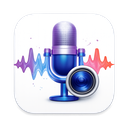

<p align="center">
  
</p>

<h1 align="center">AudioCaptor</h1>

<p align="center">
  <strong>Portable system audio recorder for Windows</strong>
</p>

<p align="center">
  Record your microphone, system audio, or both — with flexible output modes.<br>
  No installation required. Just run the exe.
</p>

<p align="center">
  English · <a href="README_UK.md">Українська</a>
</p>

---

## Features

- **System audio capture (loopback)** — record what you hear through your speakers
- **Microphone recording** — capture from any connected mic
- **Real-time mixing** — combine mic and system audio with adjustable volume levels
- **Multiple output modes** — Microphone, System audio, Mix, Mix + Mic, Mix + Loopback, Separate Files
- **Recording profiles** — save per-profile output folder, mode, sample rate, format, volume, and filenames
- **Global hotkey** — start, pause, and stop recording from any window (default: `Pause/Break` key)
  - Short press: start / pause / resume
  - Long press (≥500ms): stop and save
- **System tray** — minimize to tray, control recording from tray menu
- **Sound notifications** — audible feedback for start, pause, and stop events
- **Themes** — Auto, Light, and Dark mode
- **Internationalization** — English and Ukrainian
- **Portable** — single `.exe` file, all data stored in `AudioCaptor-data/` folder
- **Accessible** — full screen reader support, keyboard navigation, ARIA labels
- **WAV or Opus** — lossless WAV, or Opus files many times smaller, made automatically when a recording stops; 8, 16, 44.1, or 48 kHz

## Quick Start

1. Download `AudioCaptor.exe`
2. Place it in any folder (e.g., `C:\Tools\AudioCaptor\`)
3. Run it

On first launch, AudioCaptor creates the following alongside the exe:

```
AudioCaptor.exe
AudioCaptor-data/
├── settings.json      # Your preferences (auto-saved)
├── settings.unreadable.json  # Only if settings.json could not be read: a copy of the old file
├── conversion-queue.json     # Only while recordings wait to be converted to Opus
├── logs/              # Diagnostic logs
└── Recordings/        # Default recordings folder
AudioCaptor-webview/   # Cache of the built-in browser
```

The built-in browser that draws the window (Microsoft Edge WebView2) keeps its cache and its own state in the `AudioCaptor-webview` folder. None of your settings or recordings are in it, so it needs no backup; if you delete it while AudioCaptor is closed, the app creates it again. Versions 0.1.1 and older kept this data in `%LOCALAPPDATA%\com.audiocaptor.app`: once you no longer run them, you can delete that folder.

## Usage

1. **Select devices** — choose your microphone and/or system audio device from the dropdowns
2. **Configure a profile** — choose output mode, sample rate, format, volume levels, and output folder
3. **Hit Record** — or use the global hotkey (`Pause/Break` by default)
4. **Pause / Resume** — short press the hotkey or use the UI buttons
5. **Stop** — long press the hotkey (≥500ms) or click Stop

Recordings are saved with automatic timestamps (e.g., `mix_2026-03-31_14-30-00.wav`): as WAV files, or as `.opus` files when the profile's format is Opus.

## Recording Formats

The **Format** list of a profile sets the kind of file you get:

| Format | What you get | An hour of recording |
|--------|--------------|----------------------|
| WAV (uncompressed) | The sound exactly as recorded. The default. | 691 MB at 48 kHz |
| Opus — speech (mono) | Small files for meetings and lectures. Both channels are mixed into one. | about 14 MB |
| Opus — music (stereo) | Music and other system audio, in stereo. | about 43 MB |

Opus is a lossy format: it leaves out what the ear hardly notices, so the sound is very close to the WAV but not identical. Choose WAV when you need the recording exactly as it was, for example to edit it later.

How a recording becomes an Opus file:

- The recording itself is written as WAV, as before. When you stop it, AudioCaptor converts it in the background. An hour of recording takes about half a minute on a recent PC.
- The new file gets the same name with `.opus` at the end. AudioCaptor checks that it can be decoded and lasts exactly as long as the recording, and only then deletes the WAV, so one file per track is left.
- Recordings are converted one at a time, in the order you stopped them. You can start a new recording meanwhile.
- The screen reader says when a conversion starts and when all conversions are finished. `Alt+I` says about how long is left and how many files are waiting.
- If a recording cannot be converted, it is not lost: the WAV stays, the warning sound plays and a message says where the WAV is.
- If you exit while recordings are being converted, AudioCaptor asks first. If you do exit, the WAV stays whole, and the conversion is finished the next time AudioCaptor starts.

Opus and the sample rate of a profile:

- **48 kHz** gives the best quality.
- **44.1 kHz** is converted to 48 kHz, because Opus has no 44.1 kHz.
- At **16 and 8 kHz** the sample rate itself limits the quality: a 16 kHz recording holds no sound above 8 kHz, an 8 kHz recording none above 4 kHz, whatever the format. More bits would not sound better there, so AudioCaptor makes smaller files: speech at 24 and 16 kbit/s instead of 32, music at 48 and 32 kbit/s instead of 96.

AudioCaptor 0.1.2 and older do not know the format of a profile. If you go back to one of them, your profiles stay, but they record WAV, and you choose the format again after you update.

## Keyboard Shortcuts

| Shortcut | Action |
|----------|--------|
| `Pause/Break` | Global hotkey — start / pause / stop recording |
| `Alt+S` | Start recording |
| `Alt+P` | Pause recording |
| `Alt+R` | Resume recording |
| `Alt+T` | Stop recording |
| `Alt+I` | Announce current status, including a running conversion (for screen readers) |
| `Tab` | Navigate between UI elements |
| `Escape` | Close dialogs / minimize to tray |

The global hotkey works even when AudioCaptor is not focused. You can change it in Settings.

## System Requirements

- **OS**: Windows 10 or later
- **Runtime**: WebView2 (pre-installed on Windows 11; available on most Windows 10 machines)
- **Audio**: At least one audio input or output device
- **Disk**: ~10 MB for the executable; recording space depends on duration and sample rate

## Scoop Installation

AudioCaptor is available via [Scoop](https://scoop.sh/), a Windows package manager:

```powershell
scoop bucket add ruslan-rv-ua https://github.com/ruslan-rv-ua/scoop-bucket
scoop install audiocaptor
```

When installed via Scoop, the `AudioCaptor-data/` folder is automatically persisted across updates. The `AudioCaptor-webview/` folder is not: it lies in the folder of each version, so after an update the browser starts with an empty cache.

## Accessibility

AudioCaptor is built with accessibility as a top priority:

- Every UI element is labeled for screen readers (NVDA, JAWS, Narrator)
- Full keyboard navigation — no mouse required
- Sound notifications mirror visual state changes
- Global hotkey works from any application
- `Alt+I` announces current recording status
- The start and the end of a conversion to Opus are announced; `Alt+I` says about how long is left
- About dialog with hotkeys reference and quick start guide

## License

[MIT](LICENSE)

## Development

See [DEVELOPMENT.md](DEVELOPMENT.md) for build instructions and architecture overview.
