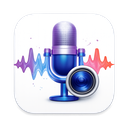

<p align="center">
  
</p>

<h1 align="center">AudioCaptor</h1>

<p align="center">
  <strong>Портативний записувач системного звуку для Windows</strong>
</p>

<p align="center">
  Записуйте мікрофон, системний звук або обидва — з гнучкими режимами виведення.<br>
  Не потребує встановлення. Просто запустіть exe-файл.
</p>

<p align="center">
  <a href="README.md">English</a> · Українська
</p>

---

## Можливості

- **Запис системного звуку (loopback)** — записуйте те, що чуєте через динаміки
- **Запис мікрофона** — захоплюйте звук з будь-якого під'єднаного мікрофона
- **Мікшування в реальному часі** — поєднуйте мікрофон і системний звук з регулюванням гучності
- **Кілька режимів виведення** — Мікрофон, Системний звук, Мікс, Мікс + Мікрофон, Мікс + Системний, Окремі файли
- **Профілі запису** — зберігайте папку, режим, частоту дискретизації, формат, гучність і шаблони назв файлів для кожного профілю
- **Глобальна гарячою клавіша** — старт, пауза та зупинка запису з будь-якого вікна (за замовчуванням: `Pause/Break`)
  - Короткий натиск: старт / пауза / продовження
  - Довгий натиск (≥500 мс): зупинка і збереження
- **Системний трей** — згортайте в трей, керуйте записом з меню трея
- **Звукові сповіщення** — звуковий зворотний зв'язок при старті, паузі та зупинці
- **Теми** — Авто, Світла та Темна
- **Інтернаціоналізація** — англійська та українська
- **Портативний** — один `.exe` файл, усі дані зберігаються в папці `AudioCaptor-data/`
- **Доступний** — повна підтримка скрінрідерів, клавіатурна навігація, ARIA-мітки
- **WAV, Opus або MP3** — WAV без втрат або в багато разів менші файли Opus і MP3, які програма робить сама після зупинки запису; 8, 16, 44,1 або 48 кГц

## Швидкий старт

1. Завантажте `AudioCaptor.exe`
2. Помістіть у будь-яку папку (наприклад, `C:\Tools\AudioCaptor\`)
3. Запустіть

При першому запуску AudioCaptor створить таку структуру поруч з exe:

```
AudioCaptor.exe
AudioCaptor-data/
├── settings.json      # Ваші налаштування (зберігаються автоматично)
├── settings.unreadable.json  # Лише якщо settings.json не вдалося прочитати: копія старого файлу
├── conversion-queue.json     # Лише поки записи чекають на конвертацію в Opus чи MP3
├── logs/              # Діагностичні логи
└── Recordings/        # Папка для записів за замовчуванням
AudioCaptor-webview/   # Кеш вбудованого браузера
```

Вбудований браузер, який малює вікно (Microsoft Edge WebView2), тримає свій кеш і власний стан у папці `AudioCaptor-webview`. Ваших налаштувань і записів у ній немає, тож резервна копія їй не потрібна; якщо видалити її, коли AudioCaptor закрито, програма створить її знову. Версії 0.1.1 і старіші тримали ці дані в `%LOCALAPPDATA%\com.audiocaptor.app`: коли ви їх уже не запускаєте, цю папку можна видалити.

## Використання

1. **Оберіть пристрої** — виберіть мікрофон та/або системний аудіопристрій зі списків
2. **Налаштуйте профіль** — оберіть режим виведення, частоту дискретизації, формат, рівні гучності та папку
3. **Натисніть Запис** — або використайте глобальну гарячу клавішу (`Pause/Break` за замовчуванням)
4. **Пауза / Продовження** — короткий натиск гарячої клавіші або кнопки в інтерфейсі
5. **Зупинка** — довгий натиск гарячої клавіші (≥500 мс) або натисніть Стоп

Записи зберігаються з автоматичними мітками часу (наприклад, `mix_2026-03-31_14-30-00.wav`): як файли WAV або, якщо формат профілю — Opus чи MP3, як файли `.opus` чи `.mp3`.

## Формати запису

Список **Формат** у профілі визначає, який файл ви отримаєте:

| Формат | Що ви отримаєте | Година запису |
|--------|-----------------|---------------|
| WAV (без стиснення) | Звук точно такий, як записано. Типовий варіант. | 691 МБ на 48 кГц |
| Opus — мовлення (моно) | Малі файли для нарад і лекцій. Обидва канали зводяться в один. | близько 14 МБ |
| Opus — музика (стерео) | Музика та інший системний звук, у стерео. | близько 43 МБ |
| MP3 — мовлення (моно, 64 кбіт/с) | Наради й лекції у форматі, який відкриває будь-який програвач, телефон і сайт. Обидва канали зводяться в один. | близько 29 МБ |
| MP3 — стандарт (128 кбіт/с) | Будь-який звук у стерео, найпоширеніший вид MP3. | близько 58 МБ |
| MP3 — висока якість (320 кбіт/с) | Музика в стерео, найближче до WAV, як тільки може MP3. | близько 144 МБ |

Opus і MP3 — формати зі втратами: вони відкидають те, чого вухо майже не помічає, тож звук дуже близький до WAV, але не тотожний. Opus дає ту саму якість у менших файлах, а MP3 відкривається скрізь. Вибирайте WAV, коли запис потрібен точно таким, як був, наприклад для подальшого монтажу.

Як запис стає файлом Opus чи MP3:

- Сам запис, як і раніше, пишеться у WAV. Коли ви його зупиняєте, AudioCaptor конвертує його у фоні. На сучасному комп'ютері година запису займає близько пів хвилини в Opus і близько чверті хвилини в MP3.
- Новий файл має ту саму назву із закінченням `.opus` чи `.mp3`. AudioCaptor перевіряє його, перш ніж видалити WAV, тож на кожну доріжку лишається один файл: файл Opus має розкодовуватися й тривати рівно стільки, скільки запис; файл MP3 має складатися з цілих кадрів MP3 і тривати стільки, скільки запис, разом із кількома сотими секунди тиші, які будь-який кодер MP3 додає на початку й у кінці.
- Записи конвертуються по одному, в порядку зупинки. Тим часом можна почати новий запис.
- Скрінрідер каже, коли конвертація починається і коли всі конвертації завершено. `Alt+I` каже, скільки приблизно лишилося і скільки файлів чекає.
- Якщо запис не вдалося конвертувати, його не втрачено: WAV лишається, лунає звук попередження, а повідомлення каже, де лежить WAV.
- Якщо ви виходите, поки записи конвертуються, AudioCaptor спершу питає. Якщо ви таки вийдете, WAV лишиться цілим, а конвертація завершиться при наступному запуску AudioCaptor.

Opus і частота дискретизації профілю:

- **48 кГц** дає найкращу якість.
- **44,1 кГц** перетворюється на 48 кГц, бо Opus не має частоти 44,1 кГц.
- На **16 і 8 кГц** якість обмежує сама частота: запис на 16 кГц не містить звуків, вищих за 8 кГц, а запис на 8 кГц — вищих за 4 кГц, хоч який формат. Більше бітів там не звучало б краще, тож AudioCaptor робить менші файли: мовлення на 24 і 16 кбіт/с замість 32, музика на 48 і 32 кбіт/с замість 96.

MP3 і частота дискретизації профілю:

- **44,1 і 48 кГц** дають бітрейти з таблиці вище.
- На **16 кГц** MP3 дозволяє щонайбільше 80 кбіт/с у стерео і 48 кбіт/с у моно, тож «стандарт» і «висока якість» дають 80 кбіт/с (близько 36 МБ на годину), а «мовлення» — 48 кбіт/с (близько 22 МБ).
- На **8 кГц** MP3 дозволяє щонайбільше 32 кбіт/с у стерео і 16 кбіт/с у моно: «стандарт» і «висока якість» дають 32 кбіт/с (близько 14 МБ на годину), «мовлення» — 16 кбіт/с (близько 7 МБ).

MP3 у Windows N: AudioCaptor робить файли MP3 кодером MP3, який постачається з Windows, тож окрема бібліотека не потрібна. У версіях Windows N і KN такого кодера немає, доки не встановлено Media Feature Pack. Там запис у профілі з MP3 лишається у WAV: лунає звук попередження, а повідомлення каже, як отримати кодер. Установіть Media Feature Pack у розділі «Додаткові компоненти» параметрів Windows, перезавантажте комп'ютер, і наступні записи збережуться в MP3.

AudioCaptor 0.1.2 і старіші не знають формату профілю. Якщо ви повернетеся до однієї з цих версій, профілі лишаться, але писатимуть WAV, а після оновлення формат доведеться вибрати знову. AudioCaptor 0.2.0 знає WAV і Opus, але не MP3: там профіль із форматом MP3 пише WAV, а після оновлення формат знову працює, якщо ви не зберігали цей профіль у 0.2.0.

## Клавіатурні скорочення

| Скорочення | Дія |
|------------|-----|
| `Pause/Break` | Глобальна гаряча клавіша — старт / пауза / зупинка запису |
| `Alt+S` | Почати запис |
| `Alt+P` | Призупинити запис |
| `Alt+R` | Продовжити запис |
| `Alt+T` | Зупинити запис |
| `Alt+I` | Оголосити поточний статус, зокрема конвертацію, що триває (для скрінрідерів) |
| `Tab` | Навігація між елементами інтерфейсу |
| `Escape` | Закрити діалог / згорнути в трей |

Глобальна гаряча клавіша працює навіть коли AudioCaptor не у фокусі. Змінити її можна в Налаштуваннях.

## Системні вимоги

- **ОС**: Windows 10 або новіше
- **Середовище**: WebView2 (попередньо встановлено на Windows 11; доступне на більшості машин з Windows 10)
- **Аудіо**: Щонайменше один пристрій введення або виведення звуку
- **Диск**: ~10 МБ для виконуваного файлу; місце для записів залежить від тривалості та частоти дискретизації

## Встановлення через Scoop

AudioCaptor доступний через [Scoop](https://scoop.sh/), пакетний менеджер для Windows:

```powershell
scoop bucket add ruslan-rv-ua https://github.com/ruslan-rv-ua/scoop-bucket
scoop install audiocaptor
```

При встановленні через Scoop папка `AudioCaptor-data/` автоматично зберігається між оновленнями. Папка `AudioCaptor-webview/` — ні: вона лежить у папці кожної версії, тож після оновлення браузер починає з порожнім кешем.

## Доступність

AudioCaptor створено з пріоритетом на доступність:

- Кожен елемент інтерфейсу має мітки для скрінрідерів (NVDA, JAWS, Narrator)
- Повна клавіатурна навігація — миша не потрібна
- Звукові сповіщення дублюють візуальні зміни стану
- Глобальна гаряча клавіша працює з будь-якого застосунку
- `Alt+I` оголошує поточний статус запису
- Початок і завершення конвертації в Opus чи MP3 оголошуються; `Alt+I` каже, скільки приблизно лишилося
- Діалог «Про програму» з довідкою по гарячих клавішах та швидким стартом

## Ліцензія

[MIT](LICENSE)

## Розробка

Див. [DEVELOPMENT.md](DEVELOPMENT.md) — інструкції зі збирання та огляд архітектури.
